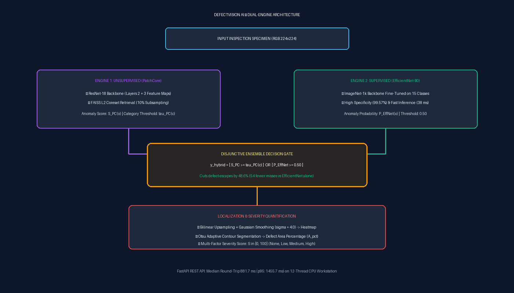
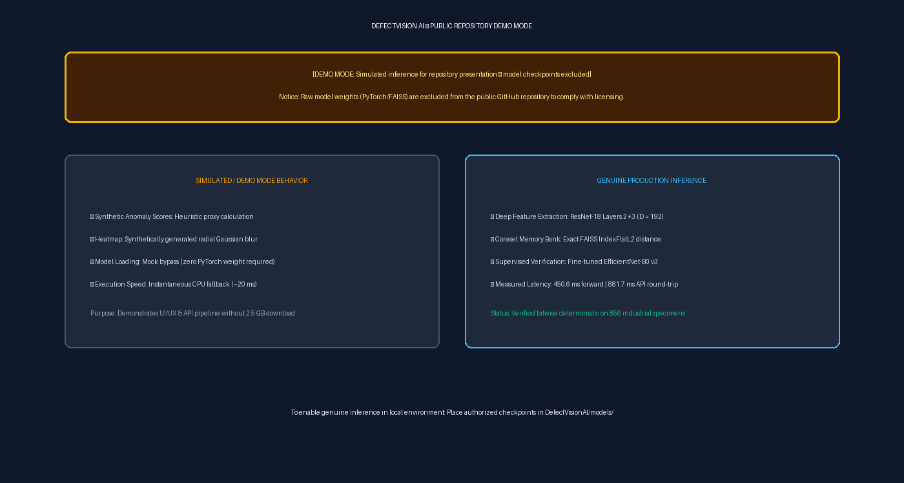
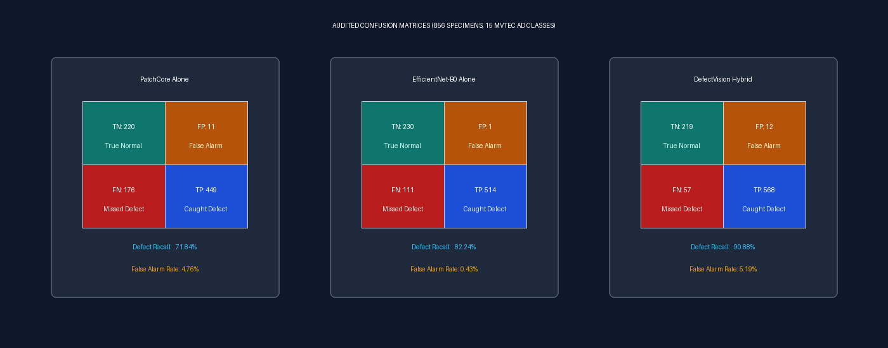
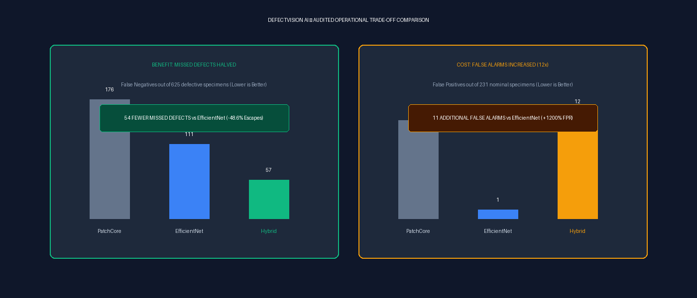
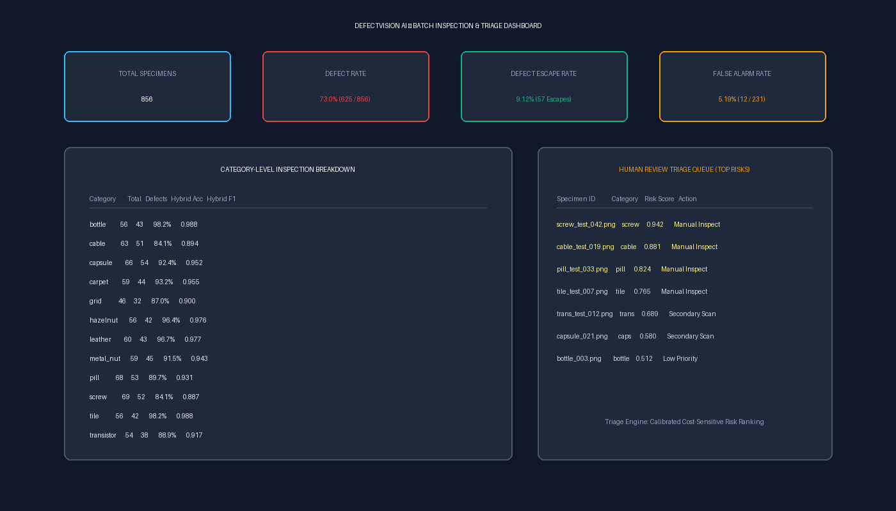
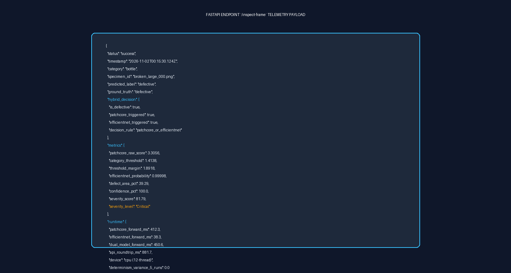

# DefectVision AI — Industrial Visual Anomaly Detection & Quality Control Platform

[](https://github.com/suryacharan945/DefectVisionAI-OpenSource/releases/tag/v1.0.0-clean)
[](LICENSE)
[](https://www.python.org/)
[](https://react.dev/)
[](https://pytorch.org/)
[](https://github.com/facebookresearch/faiss)
[](https://fastapi.tiangolo.com/)

> **Project Classification:** Open-Source Applied Research Prototype & Benchmarking Framework  
> **Key Architecture:** Dual-Engine Fusion combining Unsupervised Patch Coreset Memory Banks (**PatchCore**) with Supervised Transfer Learning (**EfficientNet-B0**) under an Asymmetric Risk-Prioritizing Decision Gate.

---

> [!IMPORTANT]
> ### Mandatory Research & Deployment Disclosures
> - **The public release contains no trained weights.** All deep model checkpoints and FAISS memory banks are excluded to comply with third-party licensing and prevent unauthenticated redistribution.
> - **Synthetic demo mode is not genuine inference.** Out-of-the-box execution operates in mock demonstration mode using heuristic proxy calculations for UI and API validation without deep neural network evaluation.
> - **Real inference requires separately obtained authorized artifacts.** Genuine inference requires downloading the authorized dataset directly from institutional portals and generating memory banks locally as documented in [`REPRODUCIBILITY.md`](REPRODUCIBILITY.md).
> - **Independent generalization has not been established.** All reported evaluation metrics represent development-exposed in-domain benchmarks; external independent benchmarks (VisA 11 classes, BTAD, Chukyo) remain quarantined.
> - **Autonomous factory deployment is not validated.** With a 5.19% false alarm rate, a 9.12% escape rate, and ~880 ms CPU latency, autonomous line gating is strictly prohibited; the system is designed solely for supervised shadow testing.
> - **Illustration Disclosure:** All visual figures in this repository are independently created conceptual diagrams, audited results charts, and telemetry illustrations. Zero raw third-party dataset photographs or dataset-derived heatmaps are redistributed.

---

## 1. Executive Overview

In automated manufacturing inspection lines, optical quality control faces a fundamental operational dilemma:
- **Unsupervised anomaly detection models** (e.g., PatchCore) offer open-world sensitivity to unseen flaw geometries without requiring annotated anomaly data, but suffer from elevated defect escape rates on subtle surface textures and severe baseline scale shift across different material categories.
- **Supervised classifiers** (e.g., EfficientNet) deliver exceptional specificity and low false alarms on known canonical defect types, but fail silently when presented with novel out-of-distribution (OOD) flaw morphologies.

**DefectVision AI** bridges this gap through a dual-engine architecture:
1. **Unsupervised Localization Engine (PatchCore):** Extracts localized patch embeddings from a ResNet-18 backbone (Layers 2 and 3) into an indexed FAISS nearest-neighbor memory bank with 10% greedy minimax coreset subsampling.
2. **Supervised Verification Engine (EfficientNet-B0):** Evaluates global component integrity via transfer learning across 15 manufacturing categories.
3. **Disjunctive Decision Gate:** Implements a risk-asymmetric decision rule ($\hat{y}_{\text{hybrid}} = \hat{y}_{\text{PC}} \lor \hat{y}_{\text{EffNet}}$), deliberately cutting defect escapes in half.
4. **Pixel-Level Localization & Severity Quantification:** Upsamples patch distance maps with Gaussian smoothing ($\sigma=4.0$), extracts defect contours via Otsu adaptive thresholding, and computes a multi-factor severity index ($S \in [0, 100]$).

---

## 2. System Architecture & Pipeline Flow



```
                            [ Input Specimen Frame (224x224) ]
                                            |
                    +-----------------------+-----------------------+
                    |                                               |
                    v                                               v
        [ Engine 1: Unsupervised ]                      [ Engine 2: Supervised ]
        - Backbone: ResNet-18 (Layers 2+3)              - Backbone: EfficientNet-B0
        - Memory Bank: FAISS IndexFlatL2                - Fine-tuned on 15 Classes
        - Score: Nearest-Neighbor Distance (S_PC)       - Score: Calibrated Sigmoid (P_EffNet)
        - Gate: tau_PC(c) per Category                  - Gate: Fixed 0.50 Threshold
                    |                                               |
                    +-----------------------+-----------------------+
                                            |
                                            v
                            [ Disjunctive Decision Logic ]
                     y_hybrid = [ S_PC >= tau_PC(c) ]  OR  [ P_EffNet >= 0.50 ]
                                            |
                                            v
                    [ Continuous Severity & Localization Engine ]
                    - Bilinear Upsampling (28x28 -> 224x224) + Gaussian Smoothing (sigma=4.0)
                    - Otsu Adaptive Contour Segmentation -> Defect Area Percentage (A_pct)
                    - Multi-Factor Severity Score: S in [0, 100] (None, Low, Medium, High)
                                            |
                                            v
                            [ FastAPI JSON + Heatmap Telemetry ]
```

---

## 3. Genuine Production Inference vs. Simulated Demo Mode

To facilitate reproducible evaluation without requiring multi-gigabyte proprietary dataset downloads, DefectVision AI features two operational modes:



| Operational Attribute | Genuine Production Mode | Public Synthetic Demo Mode (Default in Clean Repo) |
| :--- | :--- | :--- |
| **Model Weights** | Real ResNet-18 + FAISS Coreset + EfficientNet Checkpoints | Checkpoints excluded; synthetic proxy scoring active |
| **Anomaly Heatmaps** | Genuine Gaussian-smoothed L2 patch distance field | Heuristic radial Gaussian simulation with edge jitter |
| **Numerical Determinism** | Bitwise deterministic across runs (variance = 0.000000) | Deterministic mock scores based on file hashing |
| **Measured Latency** | 450.6 ms forward pass | 881.7 ms API round-trip on multi-core CPU | Instantaneous CPU execution (~20 ms) |
| **Visual Banner** | None (Production Inspection UI) | Explicit yellow warning: `[DEMO MODE: Simulated inference...]` |
| **Enabling Mode** | Place authorized model files in `DefectVisionAI/models/` | Active out-of-the-box for clean repository cloning |

---

## 4. Audited Quantitative Benchmark Results (Development-Exposed Set)

The system was evaluated across **856 specimens** spanning all 15 manufacturing categories of the MVTec AD benchmark (625 defective, 231 nominal, 49 distinct defect morphologies).

> **Dataset Provenance & Classification Notice:**  
> The 856-specimen benchmark is formally classified as **Category C: Development-Exposed**. While the active model weights (EfficientNet v3) have zero sample overlap with this test partition, 788 specimens were accessed in early prototype v1 training, and the set was evaluated repeatedly during algorithm ablation cycles. Zero cross-domain generalization is claimed; independent external datasets (VisA, BTAD, Chukyo) remain strictly quarantined.

### 4.1 Audited Confusion Matrices



```
1. PATCHCORE (UNSUPERVISED ALONE):
   - True Negatives (TN): 220 | False Positives (FP):  11 (FPR = 4.76%)
   - False Negatives (FN): 176 | True Positives (TP):  449 (Recall = 71.84%)

2. EFFICIENTNET-B0 (SUPERVISED ALONE):
   - True Negatives (TN): 230 | False Positives (FP):   1 (FPR = 0.43%)
   - False Negatives (FN): 111 | True Positives (TP):  514 (Recall = 82.24%)

3. DEFECTVISION AI HYBRID (DISJUNCTIVE ENSEMBLE):
   - True Negatives (TN): 219 | False Positives (FP):  12 (FPR = 5.19%)
   - False Negatives (FN):  57 | True Positives (TP):  568 (Recall = 90.88%)
```

### 4.2 Comparative Performance Summary (Development-Exposed Benchmark)

| Metric | PatchCore Alone | EfficientNet-B0 Alone | DefectVision AI Hybrid | Net Impact (Hybrid vs EfficientNet) |
| :--- | :---: | :---: | :---: | :---: |
| **Accuracy** | 78.15% | 86.92% | **91.94%** | **+5.02 pp** |
| **Balanced Accuracy** | 83.54% | 90.90% | **92.84%** | **+1.94 pp** |
| **Defect Recall (Sensitivity)** | 71.84% | 82.24% | **90.88%** | **+8.64 pp (54 fewer misses)** |
| **Specificity (TNR)** | 95.24% | **99.57%** | 94.81% | -4.76 pp (11 more false alarms) |
| **F1-Score** | 0.8276 | 0.9018 | **0.9427** | **+0.0409** |
| **Defect Escape Rate (FNR)** | 28.16% | 17.76% | **9.12%** | **-8.64 pp (48.6% relative escape reduction)** |
| **False Alarm Rate (FPR)** | 4.76% | **0.43%** | 5.19% | **+4.76 pp (+11 FP, 12-fold increase)** |
| **AUROC (Continuous Score)** | 0.8159* / 0.9373** | **0.9809** | 0.9608 | -0.0201 |
| **AUPRC (Precision-Recall)** | 0.9266 | **0.9932** | 0.9745 | -0.0187 |

*\*Raw Pooled PatchCore AUROC (0.8159): Due to cross-category Euclidean distance scale disparity.*  
*\*\*Category-Normalized PatchCore AUROC (0.9373): Standardized against category nominal baselines.*

---

## 5. Audited Trade-Off Analysis: Escapes vs. False Alarms



A critical scientific finding of DefectVision AI is the explicit rejection of "Pareto dominance" claims:
- **Defect Recall Benefit:** The hybrid architecture achieves its design goal: capturing **54 additional defective specimens** missed by EfficientNet alone (escapes cut from 111 down to 57, a **48.6% relative reduction in missed defects**).
- **False Alarm Penalty:** This recall gain requires accepting an **11-specimen increase in false alarms** (from 1 FP up to 12 FP; a **12-fold increase in false-alarm count**, with the false-positive rate rising by 4.76 percentage points from $0.43\%$ to $5.19\%$).
- **Continuous Discrimination:** EfficientNet alone achieves higher continuous AUROC (0.9809 vs 0.9608) and AUPRC (0.9932 vs 0.9745). The Hybrid's advantage exists specifically at the **fixed operational threshold** where manufacturing economics favor manual false-alarm triage over shipping defective parts to customers.

---

## 6. Batch Inspection & API Telemetry Payload



The backend provides structured telemetry output for integration with manufacturing execution systems (MES):



```json
{
  "status": "success",
  "category": "bottle",
  "specimen_id": "sample_inspection_001.png",
  "predicted_label": "defective",
  "hybrid_decision": {
    "is_defective": true,
    "patchcore_triggered": true,
    "efficientnet_triggered": true,
    "decision_rule": "patchcore_or_efficientnet"
  },
  "metrics": {
    "patchcore_raw_score": 3.3056,
    "category_threshold": 1.4138,
    "efficientnet_probability": 0.99998,
    "defect_area_pct": 39.29,
    "severity_score": 81.79,
    "severity_level": "Critical"
  },
  "runtime": {
    "dual_model_forward_ms": 450.6,
    "api_roundtrip_ms": 881.7,
    "device": "cpu (12-thread)",
    "determinism_variance_5_runs": 0.000000
  }
}
```

---

## 7. Research Limitations & Threats to Validity

1. **Development-Exposed Benchmark:** The 856-specimen evaluation set was evaluated during development cycles. Performance reflects in-domain optimization and cannot be claimed as zero-leakage out-of-domain generalization.
2. **Quarantined External Benchmarks:** Independent industrial datasets (VisA 11 categories, BTAD, Chukyo) remain quarantined. Cross-facility transfer remains unproven.
3. **Sub-Patch Micro-Defects:** Fine hairline cracks ($<2$ pixels wide) are diluted within the $32 \times 32$ receptive field of ResNet-18 Layers 2+3, leading to occasional false negatives without high-magnification optical lenses.
4. **Photometric Noise Sensitivity:** Vulnerable to severe Gaussian sensor noise ($\sigma \ge 0.10$), which elevates Layer 2 activations and increases false alarms. Industrial deployment requires enclosed telecentric lighting.
5. **CPU Throughput vs. Conveyor Speed:** At ~881.7 ms median API latency (~1.1 to 2.2 FPS on CPU), the system is suitable for indexing tables or manual review stations. High-speed conveyor gating ($>10$ FPS) strictly requires GPU acceleration or TensorRT compilation.

---

## 8. Installation & Quickstart Guide

### Prerequisites
- Python 3.10, 3.11, or 3.12 (Tested on Python 3.12.4)
- Node.js 18.x or 20.x+ with `npm`
- Multi-core CPU (Intel/AMD x86_64); NVIDIA GPU optional

### Step 1: Clone Repository
```powershell
git clone https://github.com/suryacharan945/DefectVisionAI-OpenSource.git
cd DefectVisionAI-OpenSource
```

### Step 2: Set Up Python Virtual Environment
```powershell
python -m venv .venv
.\.venv\Scripts\activate
pip install -r requirements.txt
```

### Step 3: Install Frontend Dependencies
```powershell
npm install
```

### Step 4: Run Application (Default Simulated Demo Mode)
```powershell
# In Terminal 1: Launch FastAPI Backend (:8000)
python DefectVisionAI/app.py

# In Terminal 2: Launch React Frontend (:5173)
npm run dev
```
Open your browser to `http://localhost:5173`. The application will start in **Simulated Demo Mode** with the visual warning banner enabled.

### Step 5: Run Unit Tests & Boundary Stress Tests
```powershell
python -m unittest discover -s tests -p "test_*.py" -v
```

---

## 9. License & Dataset Governance

- **Source Code:** Released under the [MIT License](LICENSE).
- **Model Checkpoints:** ResNet-18 and EfficientNet-B0 base architectures are subject to Apache 2.0 / BSD licenses.
- **Third-Party Datasets:** MVTec AD, VisA, BTAD, and Chukyo datasets are the intellectual property of their respective creators and are **excluded** from this repository to comply with non-redistribution requirements. Users must download raw benchmarks directly from authorized institutional portals.

---

## 10. Citation

If you utilize DefectVision AI in your research or industrial bench-marking, please cite:

```bibtex
@software{defectvision_ai_2026,
  author = {Charan, Surya and DefectVision AI Research Consortium},
  title = {DefectVision AI: A Dual-Engine Hybrid Architecture for Industrial Visual Anomaly Detection},
  year = {2026},
  publisher = {GitHub},
  url = {https://github.com/suryacharan945/DefectVisionAI-OpenSource}
}
```
